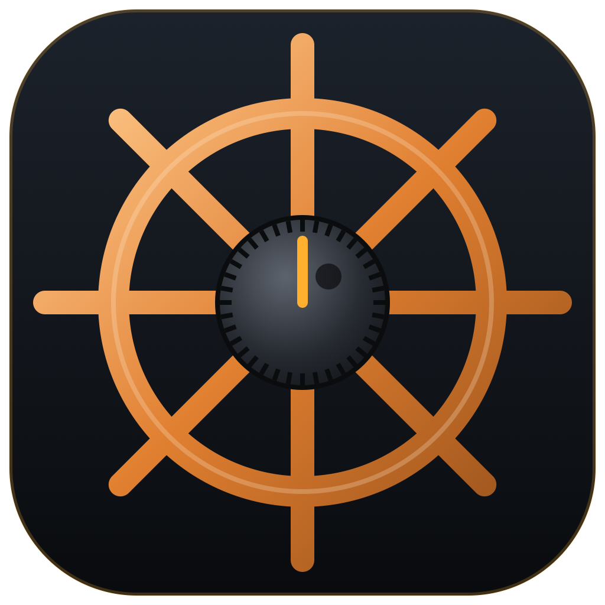

# RigHelm for iPhone



A native SwiftUI remote for [RigHelm](../righelm). It never talks to a radio itself: it
controls a RigHelm instance that owns the radio (Yaesu FTDX3000), over the same LAN
protocol a second desktop copy of RigHelm uses.

- **Finds stations by itself.** RigHelm servers beacon on UDP 4534 and answer a probe.
  iOS only lets an app use broadcasts with Apple's multicast entitlement, so the app
  also sends the probe straight to every address on the Wi-Fi subnet; the answers are
  plain unicast and need no entitlement. Stations can also be added by address.
- **Control.** Frequency (helm-wheel knob, drag on the display, ◀ ▶ steps, or type it in),
  bands, modes, VFO A/B, split, lock, ATU, antenna; receiver, filter, DSP, transmitter,
  clarifier and CW settings; S-meter, and PO/SWR/ALC while transmitting.
- **Receive audio** (24 kHz PCM over UDP) with a jitter buffer for Wi-Fi; keeps playing
  in the background.
- **Transmit with the phone's microphone.** PHONE MIC sets the radio's AM/FM/SSB MIC SEL
  menus (053, 085, 103) to USB, like RigHelm's COMPUTER MIC switch, and puts them back
  when switched off or on disconnect. The microphone goes out only while this phone has
  keyed the radio in a phone mode, and the station must have *Accept microphone audio
  for transmit* turned on.

## Transmit safety

- **Locked by default.** *Settings → Allow transmit from this phone* must be on, and it
  turns itself off every time the app starts or connects to a station.
- While locked, nothing that keys the radio leaves the phone: `TX1`, `MX1`, `AC002`
  (tune), `KY`/`EN`/`PB` playback and `VX1` are dropped in `CatClient` before they reach
  the socket (`CatCommand.isTransmit`, the same list RigHelm uses for "Block TX").
- The phone lets go when the app goes to the background, after a time-out (3 min by
  default), and when transmit is locked again. The station un-keys a client that drops
  off the network within 5 s.
- A station without a password is receive-only; that is enforced by the server.

## Build

Open `RigHelm.xcodeproj` in Xcode and run the **RigHelm** scheme, or:

```bash
xcodebuild -project RigHelm.xcodeproj -scheme RigHelm -destination 'platform=iOS Simulator,name=iPhone 17' build
```

Signing uses team G4GK5372G8 (the same as JS8 Firefly); change it under *Signing &
Capabilities* to run on another account's devices. Bundle id: `com.righelm.ios`.
iOS 17 or later.

## Layout

| path | what |
|------|------|
| `RigHelmCore/` | Swift package: the protocol (HMAC handshake, beacons, audio packets), discovery, the CAT client and its polling, the audio link, and the FTDX3000 state parser (a port of righelm's `ftdx3000-cat`). Unit tests: `swift test`. |
| `RigHelmCore/Sources/rhcheck` | Command-line check against a real server. Read-only: transmit is locked and no Set is sent. |
| `RigHelm/App` | `RigController`: connection, audio, phone mic and transmit safety. |
| `RigHelm/Audio` | AVAudioEngine playback with a jitter buffer; microphone capture resampled to 20 ms frames. |
| `RigHelm/Views` | Station list, Operate, Controls, Settings. |

```bash
cd RigHelmCore && swift test
```

```bash
cd RigHelmCore && swift run rhcheck discover
```

```bash
cd RigHelmCore && RIGHELM_PASSWORD=... swift run rhcheck listen 192.168.10.223 10
```

## Not in this version

The band scope and audio waterfall, the CW key (KEY sessions), memories, macros and the
menu editor.
